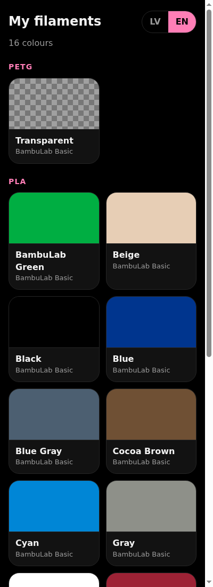
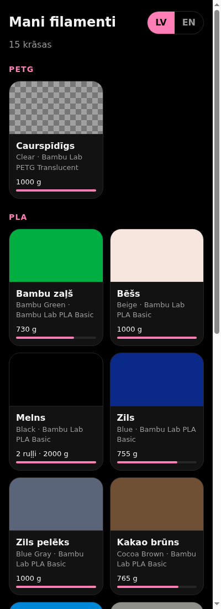

<h1 align="center">Filament Library</h1>

<p align="center">
  A phone-friendly page that shows every 3D-printer filament colour I own, in Latvian or English.
</p>

<p align="center">
  <a href="https://supred502.github.io/Filiment_Library/"><b>Open the library</b></a>
</p>

<p align="center">
  
  
</p>

## Features

- A colour swatch, name and how many grams are left for every spool, grouped by material (PLA, PETG, …)
- Several spools of the same colour show as one tile with the grams added up; nearly empty colours are highlighted
- Transparent filaments shown with a see-through checker pattern
- **LV / EN** switch; colour names are translated too, and the choice is remembered on each device
- Works on any phone, no app to install

## Updating the list

The list comes from the Filament Manager in Bambu Studio / Bambu Handy.

```bash
python3 bambu_sync.py --push
```

The first run asks for your Bambu login (leave the password empty to get a code by email if you sign in with Google). The login is kept in `~/.config/filament-sync/token`, outside this repo. The script saves `filaments.json` with only colour, material and weight, then commits and pushes it; every device shows the new list within a minute or two.

To run it every day automatically, a systemd user timer (`~/.config/systemd/user/filament-sync.timer`) calls `bambu_sync.py --push`. If the Bambu login has expired it shows a desktop notification asking you to run the script by hand once.

Bambu has no official API for this, so the script may need fixing if Bambu changes things. Colour names come from Bambu Studio's own colour table, so Bambu Studio must be installed on the computer that runs it.

## Run locally

```bash
python3 -m http.server
```

Then open <http://localhost:8000>. (Opening `index.html` straight from disk won't load the list, because browsers block reading local files.)
